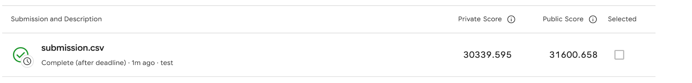
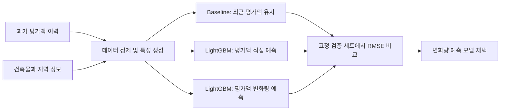
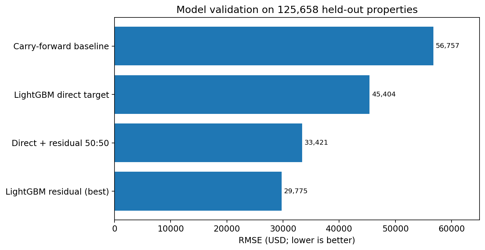
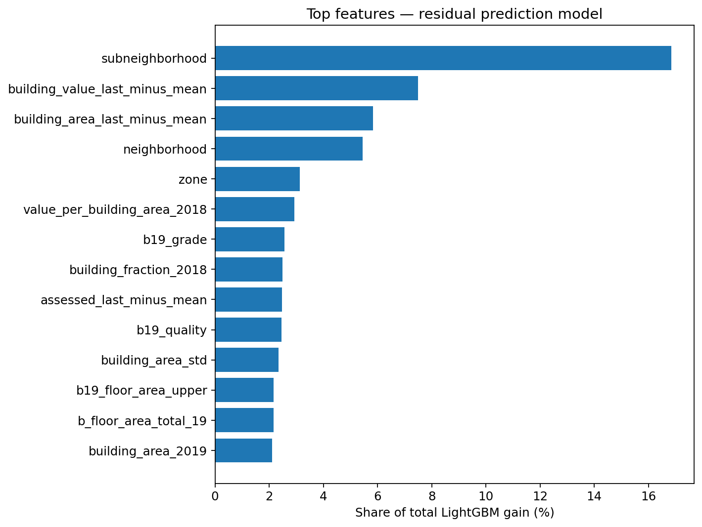
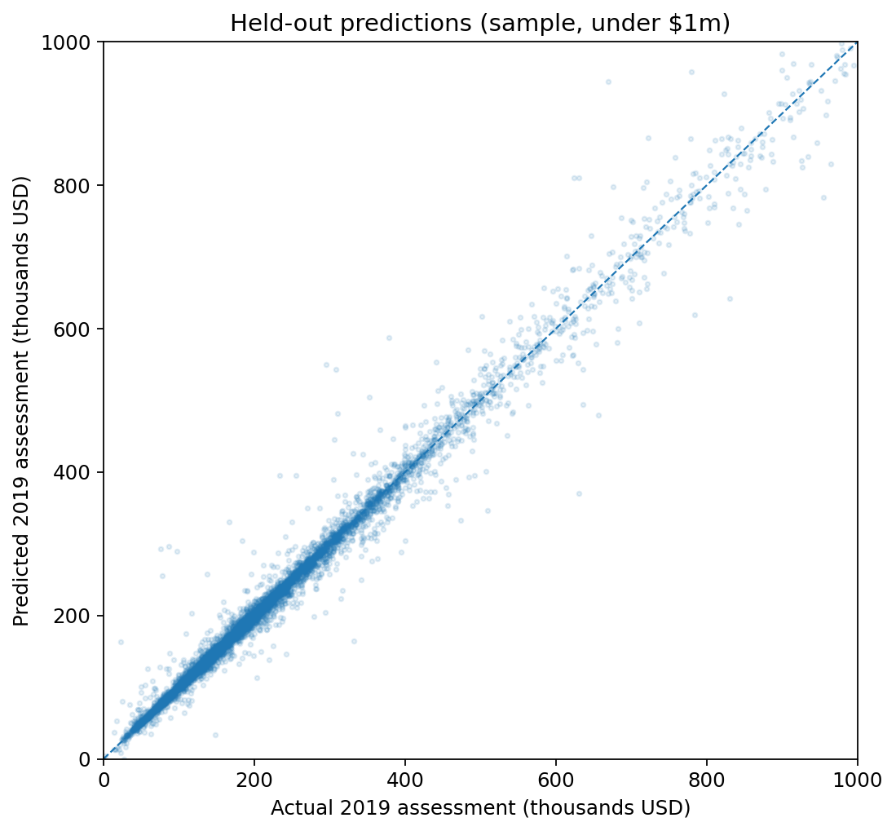
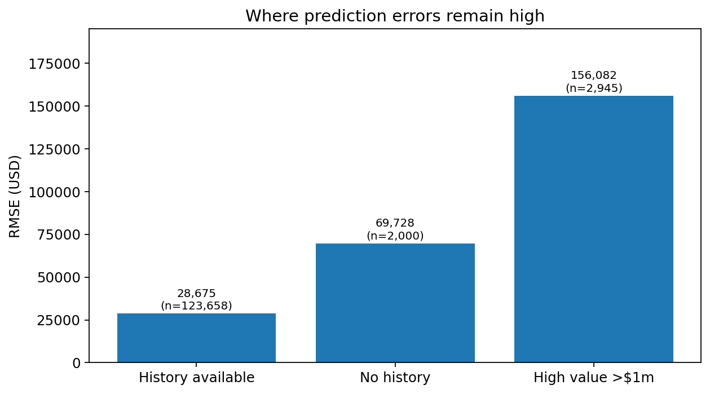

# 미국 부동산 과세평가액 예측 | Property Assessment Value Prediction

**Historical assessment + property attributes → 2019 finalized property valuation**  
`Python` · `Pandas` · `LightGBM` · `Feature Engineering` · `Regression` · `RMSE`

> **프로젝트 성격:** Baruch College STA9890 2025년 수업 경진대회 데이터를 기반으로 **2026년 11월에 새롭게 재구현한 머신러닝 프로젝트**입니다. 대회 마감 이후 제출한 결과이며, **2025년 공식 대회 우승·공식 순위 기록이 아닙니다.**

## 주요 성과

| 지표 | 결과 |
|---|---:|
| **Kaggle Private RMSE** (마감 후 제출) | **30,339.595** |
| Kaggle Public RMSE (마감 후 제출) | 31,600.658 |
| 내부 고정 검증 RMSE (선정 모델) | **29,775.36** |
| 내부 Baseline RMSE | 56,756.82 |
| **내부 검증 RMSE 개선** | **47.5% 감소** |
| 학습 데이터 / 대회 테스트 데이터 | 628,287 / 418,858 건 |
| 사용한 예측 변수 | 172개 |



*주의: 47.5% 개선율은 **동일한 로컬 검증 세트**의 Baseline 대비 수치입니다. Kaggle Private RMSE와 2025년 기존 발표 자료 점수는 서로 다른 평가 조건이므로 개선율로 직접 비교하지 않습니다.*

## 1. 문제 정의

- 2015~2018년 토지·건물·최종 과세평가액 이력과 2018~2019년 건축물 상세정보로 2019년 최종 평가액(`TARGET`)을 예측합니다.
- 이력 데이터에 결측치가 존재하고, 리모델링·건물 변경 등으로 평가액이 비연속적으로 변할 수 있습니다.
- 2019년의 `assessed_2019`, `building_value_2019`, `land_value_2019`, `TARGET`은 예측 입력에서 제외했습니다.
- 평가 척도는 **RMSE**이며 낮을수록 좋습니다.

## 2. 접근 전략



**핵심 가설:** 평가액의 절대값을 처음부터 회귀하는 것보다, **최근 알려진 평가액을 기준으로 2019년까지의 변화량을 학습**하는 것이 효과적일 수 있습니다.

변화량 타깃의 개념:

```text
base_value = 2018→2015 중 가장 최근 이용 가능한 최종 평가액
delta_target = 2019 TARGET - base_value
predicted_2019 = base_value + model.predict(features)
```

이력이 없는 경우는 학습 자료의 정답 중앙값을 기준값으로 사용했습니다.

### Feature Engineering (172개)

- **이력 요약:** 최근 평가액, 평균·표준편차, 최솟값·최댓값, 관측 연도 수
- **변화 추세:** 연도별 평가액 증감과 증감률, 최근값과 평균의 차이
- **부동산 구성:** 토지와 건물 평가액 비중, 면적 대비 가치
- **건축물 변화:** 2018~2019년 면적·건물 등급 변화, 건축연도 및 리모델링 이력
- **위치 특성:** Region, Neighborhood, Subneighborhood, Zone, School District
- **이의신청 기록:** 대회 양쪽 데이터에 제공된 관련 변수

## 3. 모델 성능 비교

| 모델 | 동일한 내부 검증 RMSE (↓) |
|---|---:|
| 직전 관측 평가액 유지 (Baseline) | 56,756.82 |
| LightGBM 직접 예측 | 45,404.28 |
| 직접 + 변화량 모델 평균 (50:50) | 33,420.65 |
| **LightGBM 변화량 예측 (최종 선택)** | **29,775.36** |



- 부동산 단위 80:20 고정 홀드아웃: 개발 502,629건 / 검증 125,658건 (`random_state=42`)
- 개발 데이터 내부에서 추가로 12%를 분리해 Early Stopping으로 학습 반복 수를 결정했습니다.
- 두 방식과 블렌딩을 동일한 외부 검증 세트로 비교했습니다.

## 4. 모델 해석과 실패 사례







| 검증 집단 | 건수 | RMSE |
|---|---:|---:|
| 과거 평가액 이력이 있는 부동산 | 123,658 | 28,675.35 |
| 과거 평가액 이력이 없는 부동산 | 2,000 | 69,727.58 |
| 2019년 실제 평가액이 $1M 초과인 부동산 | 2,945 | 156,081.59 |

**해석:** 이력이 없는 부동산과 고가 부동산에서 상대적으로 오차가 큽니다. 다음 실험에서는 이들 집단의 별도 모델, CatBoost 비교, 반복 교차검증 등을 검토할 수 있습니다. (아직 실험한 것으로 표기하지 않습니다.)

## 5. 재현 방법

실험 환경: **Python 3.13**, `requirements.txt` 참고. 대용량 CSV 로드 및 LightGBM 학습을 위한 메모리가 필요합니다.

```bash
git clone https://github.com/<YOUR_USERNAME>/property-assessment-prediction.git
cd property-assessment-prediction
python -m venv .venv
source .venv/bin/activate  # macOS/Linux; Windows: .venv\Scripts\activate
pip install -r requirements.txt
```

**원본 데이터는 배포하지 않습니다.** 접근 권한이 있는 경우 대회에서 제공한 CSV 7개를 `data/`에 직접 넣으세요. 이후:

```bash
python src/train_models.py
python src/plot_results.py
```

`outputs/`에 모델과 예측 파일이 생성되고, `figures/`에 그래프를 갱신합니다. 원본 파일의 행 순서가 바뀌지 않아야 최초 재구현 때와 같은 80:20 분할이 재현됩니다. 학습 실행 전 약 1.2GB의 원본 데이터 저장 공간과 충분한 메모리를 확보하세요.

### 공개 저장소의 파일 구성

```text
property-assessment-prediction/
├── README.md
├── README_EN.md
├── requirements.txt
├── .gitignore
├── src/
│   ├── train_models.py
│   └── plot_results.py
├── figures/
│   ├── 01_model_comparison.png
│   ├── 02_feature_importance.png
│   ├── 03_predicted_vs_actual.png
│   ├── 04_segment_errors.png
│   └── kaggle_late_submission.png
├── results/
│   ├── validation_metrics.json
│   ├── importance_direct.csv
│   └── importance_residual.csv
└── data/README.md         # 원본 데이터 미포함
```

## 6. 평가상 주의점과 한계

1. **대회 마감 후 제출:** 화면의 Private/Public RMSE는 실제 Kaggle 제출 성적이지만, 2025년 공식 대회 순위와는 다릅니다.
2. **정보 이용 시점:** 대회가 제공한 `protested_2019`와 2019년 건물 정보를 사용했습니다. 이들은 실제 연초 평가 시점에는 관측되지 않을 수 있어 **동일 모델을 그대로 운영에 배포할 수는 없습니다.**
3. **검증 데이터 재사용:** 제한된 모델 비교 이후 홀드아웃 수치가 보고되었습니다. 추가 탐색·튜닝은 교차검증으로 수행하고, 최종 홀드아웃 오차를 반복 최적화 대상으로 삼지 않아야 합니다.
4. **비공개 원본:** 원본 CSV, 개별 부동산의 계정 ID·라벨, 제출 CSV, 학습된 모델 파일은 이 저장소에서 제외했습니다. 원본 데이터 및 파생 산출물의 공유 권한은 대회 규정을 따릅니다.
5. **재현성:** 모델 코드에는 고정 시드 및 버전 정보를 기록했지만, OS·라이브러리·연산 환경 차이로 동일 수치가 완벽히 재현된다고 보장할 수 없습니다.

---

2025년 수업 프로젝트를 2026년에 재구성한 사례로, 문제 재정의와 검증 기반 모델 선택을 중심으로 정리했습니다.
