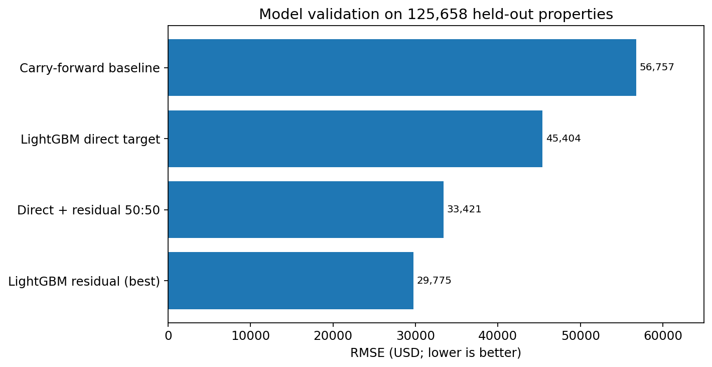
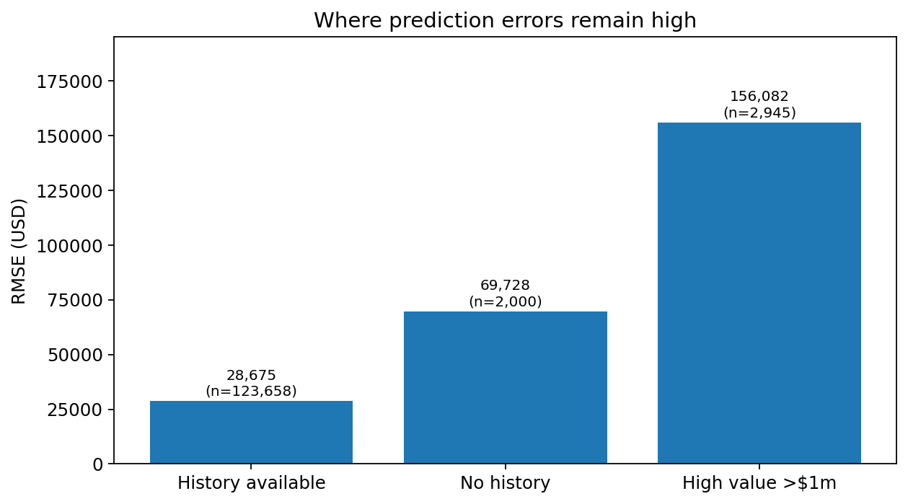
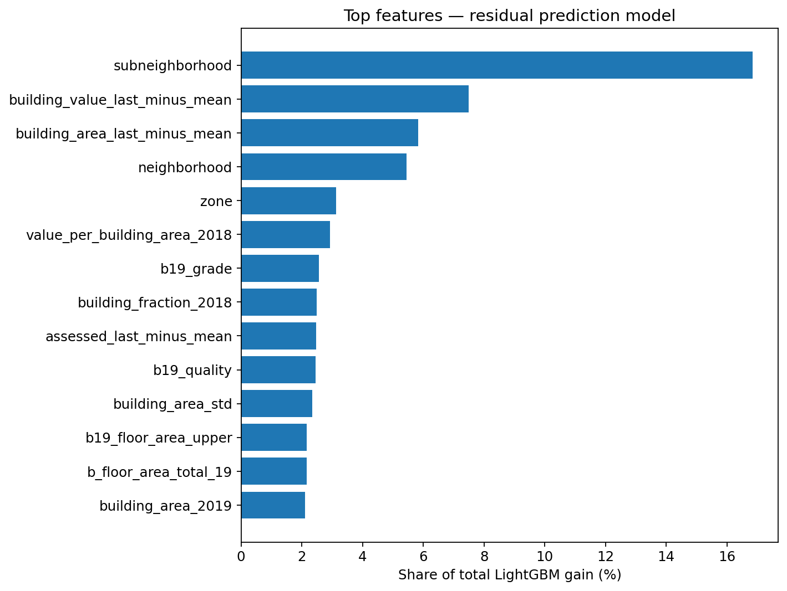

# Property Assessment Prediction — Revisiting a 2025 Course Competition

In 2025, I worked on the STA9890 property assessment prediction assignment at Baruch College using R, XGBoost, and an ensemble. My result was not particularly satisfying, and the presentation did not clearly explain why the modeling choices should work. I revisited the task in November 2026 with Python and a simpler question: **if the previous assessment is available, why predict the full next-year value rather than the change from that assessment?**

This repository documents the 2026 reimplementation, not an official result in the original 2025 competition.

## Results

| Model / evaluation | RMSE (lower is better) |
|---|---:|
| Carry forward latest available assessment — local holdout | 56,756.82 |
| Direct LightGBM prediction — same holdout | 45,404.28 |
| Equal blend of direct and residual models — same holdout | 33,420.65 |
| **Residual-target LightGBM — same holdout** | **29,775.36** |
| Kaggle Public Score — **late submission** | 31,600.658 |
| **Kaggle Private Score — late submission** | **30,339.595** |

The residual approach reduced RMSE by approximately **47.5% against the carry-forward baseline on the same local holdout**. The Kaggle submission took place **after the competition deadline**; this does **not** establish a 2025 official placement or win.


## What changed in the second attempt?

**Keeping the time information.** My earlier slides described aggregating annual assessments into averages. That is easy to implement, but an increasing and a decreasing assessment history can have the same average. The new feature pipeline retains recent values, changes, growth rates, and historical summaries instead of relying on an average alone.

**Handling missing history.** On the fixed 125,658-property validation split, 2,000 properties had no final assessment in any of 2015–2018. The pipeline uses the latest observed assessment when available, otherwise a median calculated from the development labels, and flags missing history as a feature. These cases remain a weakness.

**Changing the target.** In addition to predicting the 2019 value directly, the model was trained to predict:

```text
change = 2019 final assessment - latest available historical assessment
prediction = latest available historical assessment + predicted change
```

A development-set median is used as the reference for properties with no assessment history. The residual approach outperformed both direct prediction and the 50:50 blend on the fixed holdout.



## Evaluation and remaining errors

The labeled data had 628,287 properties. A seeded 80/20 split provided 502,629 development properties and 125,658 holdout properties. An additional development-only split selected the number of LightGBM boosting rounds. Because the holdout was also used to choose among several approaches, the local 29,775.36 score is not presented as an entirely untouched final test result; the separate Kaggle score provides another check.

| Holdout group | Properties | Residual-model RMSE |
|---|---:|---:|
| Historical assessment available | 123,658 | 28,675.35 |
| No historical assessment | 2,000 | 69,727.58 |
| Actual 2019 assessment above $1 million | 2,945 | 156,081.59 |



The model still struggles with properties without assessment history and high-value properties. Separate models for those groups are ideas for future experiments, **not work already completed**.

One practical limit matters: the competition supplied 2019 building attributes and 2019 protest information for both train and test records. Those may not be known at the start of the year in a production assessment workflow. The measured result is a retrospective competition prediction, not proof that an early-year deployment would achieve the same score.



## Run locally

The original competition data are **not redistributed** in this repository. With authorized access, place the seven CSVs in `data/` (see `data/README.md`). The current training code loads the assessment train/test histories and the 2018 and 2019 building-detail files.

```bash
python -m venv .venv
source .venv/bin/activate
pip install -r requirements.txt
python src/train_models.py
python src/plot_results.py
```

Python 3.13 was used. The program saves models and predictions to ignored `outputs/`. Reproducing the same holdout also requires preserving the original training CSV row order.

**Project provenance:** the original 2025 course project was done in R. The 2026 Python reimplementation used generative AI assistance for coding and analysis. Results here are reported from the executable pipeline and Kaggle's post-deadline submission record, not claimed as an official 2025 ranking.
