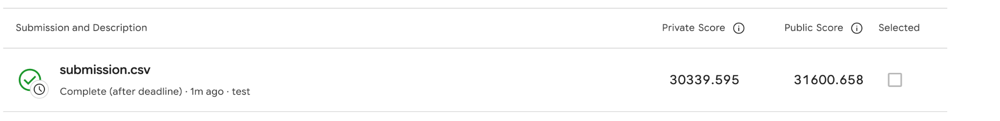

# Property Assessment Value Prediction — 2026 Reimplementation

**Regression project based on Baruch STA9890 Spring 2025's property assessment prediction competition.** This was rebuilt in November 2026 and submitted **after the original deadline**. It is **not an official 2025 competition placement**.

**Tech:** Python, Pandas, LightGBM, feature engineering, regression, RMSE.

## Verified results

| Metric | Result |
|---|---:|
| Late-submission Kaggle private RMSE | **30,339.595** |
| Late-submission Kaggle public RMSE | 31,600.658 |
| Local fixed-holdout residual LightGBM RMSE | **29,775.36** |
| Local carry-forward baseline RMSE | 56,756.82 |
| Improvement over baseline *on the same local holdout* | **47.5% lower RMSE** |
| Labeled train parcels / held-out competition parcels | 628,287 / 418,858 |
| Engineered model features | 172 |



## Key methodology

- Prepared assessment histories (2015–2018) and available 2018–2019 building records; explicitly excluded all 2019 targets and components absent at competition test time.
- Encoded historical changes, rolling summary statistics, geographic categories, building area changes, and remodeling signals.
- Compared (1) latest-assessment carry-forward, (2) direct-target LightGBM, (3) residual-target LightGBM, and (4) several fixed blends.
- Chose **predicting the difference from the last available assessment**, then adding it to that assessment, based on lower held-out RMSE.
- Used an 80:20 parcel-level train/holdout split; boosting round count was selected with an additional 12% internal split.


## Error analysis

| Group | n | RMSE |
|---|---:|---:|
| Historical assessment available | 123,658 | 28,675.35 |
| No historical assessment | 2,000 | 69,727.58 |
| Assessed value >$1m | 2,945 | 156,081.59 |


## Reproduction

With lawful access to the seven original CSV files, place them in `data/`. On Python 3.13:

```bash
pip install -r requirements.txt
python src/train_models.py
python src/plot_results.py
```

Data are **not** published in this repository. The scripts place model weights and parcel-level outputs under ignored `outputs/`.

## Limitations and ethical disclosure

- The late Kaggle score does not constitute an official ranking or win in Spring 2025.
- The competition supplied 2019 building details and `protested_2019` to both train and test. Those features may not be known at the beginning of the assessment year in a real-world system. Retrospective performance cannot be claimed as a deployable early-year forecast.
- Parcel-level data, labels, prediction file and model weights are omitted from public version pending redistribution rights.
- See [Korean project report](README.md) for full model comparisons and figures.
